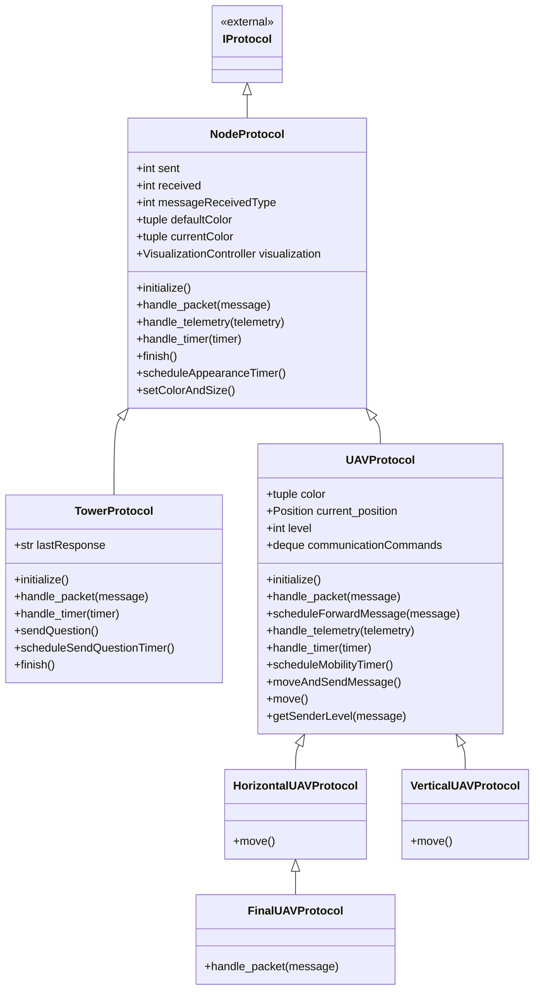

# Diagrama de classes de broadcast

O diagrama mostra as seis classes definidas nesta pasta e sua herança. `IProtocol` pertence à biblioteca GraDyS. Cada classe lista seus métodos declarados; os demais são herdados. Os tipos dos atributos são indicados conforme as anotações ou o uso no código.

A seta com triângulo aponta para a classe base. `lastResponse` e `current_position` começam com `None`.

- **NodeProtocol**: mantém contadores e controla a aparência dos nós.
- **TowerProtocol**: envia perguntas periodicamente e recebe respostas do nível 1.
- **UAVProtocol**: encaminha perguntas para níveis superiores e respostas para níveis inferiores, enviando as mensagens enfileiradas após o movimento.
- **HorizontalUAVProtocol**: implementa movimento no eixo X.
- **VerticalUAVProtocol**: implementa movimento no eixo Y.
- **FinalUAVProtocol**: herda o movimento horizontal e responde imediatamente às perguntas recebidas de níveis inferiores.

`main.py` monta a simulação e `constants.py` define as constantes; nenhum deles declara classes. `ANSWERS`, em `final_uav_protocol.py`, é uma constante do módulo.
