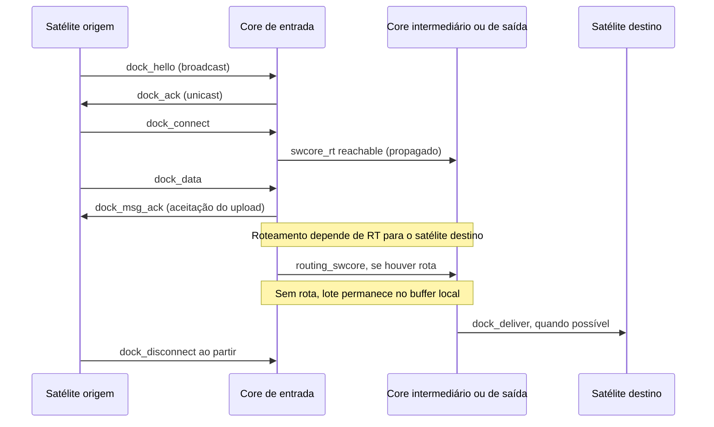
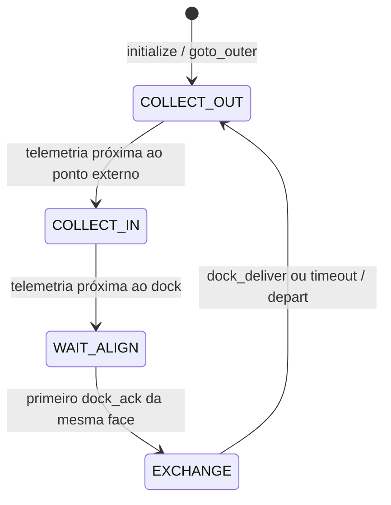

# Arquitetura atual da simulação

Este documento descreve a base copiada para `tarefa2`, inspecionada em 15/11/2026. O SwCore implementado transporta lotes de dados entre satélites por meio do core. Não há ainda tópicos, assinaturas, filtros, PSPeers ou entrega de aplicação destinada a UAVs do core. As possibilidades de extensão abaixo são orientações para etapas futuras, não funcionalidades implementadas.

Atualização da etapa de configuração: `main.py` agora expõe `parse_args(argv)` e aceita `--pubsub`, que força `star` e `swcore`, mesmo diante de valores conflitantes na CLI. `PUBSUB_ENABLED` em `config.py` define a ativação padrão; o argumento resolvido `args.pubsub` representa a ativação desta execução, sem alterar o módulo de configuração. Os demais parâmetros novos (`PUBSUB_TOPICS`, `PSPEER_SLOTS`, `PUBSUB_SEED`, `PUBSUB_PUBLICATION_INTERVAL`, `PUBSUB_SUBSCRIPTION_INTERVAL`) estão no mesmo arquivo e permanecem reservados à implementação futura. Os slots `(0, 3, 6)` são índices de rims. Nenhum gerador de eventos ou PSPeer foi criado. Sem ativação Pub/Sub, os padrões originais descritos abaixo continuam válidos.

## 1. Composição e inicialização

[main.py](../src/main.py), função `main()`, configura o simulador, instancia os nós por meio de `SimulationBuilder.add_node()`, instala os handlers e chama `build()` e `start_simulation()`.

Os nós são adicionados nesta ordem: sensores, core, satélites N/E/S/W. A topologia `star` cria um hub e oito nós de borda; `random` cria nove UAVs móveis. Os padrões da CLI são `random` e `flooding`, portanto SwCore precisa ser selecionado explicitamente:

```powershell
python -m src.main --no-viz --routing-strategy swcore --topology star
```

[uav.py](../src/uav.py) monta classes por herança múltipla. Os protocolos base cuidam da mobilidade, posição e buffer; os mixins acrescentam vizinhança, docking, roteamento e visualização. As funções `make_core_hub`, `make_core_rim` e `make_random_uav` selecionam o mixin de roteamento em `_ROUTING_MIXINS`. `make_satellite` não inclui `SWCoreMixin`: passa `swcore=True` à fábrica do satélite para ativar os eventos de conexão e ACK de upload.

| Arquivo | Responsabilidade efetiva |
| --- | --- |
| [core_hub.py](../src/core_hub.py) | Hub estacionário, líder de mobilidade, orientação da formação e beacons |
| [core_rim.py](../src/core_rim.py) | Seguidores do hub, atualização dos deslocamentos relativos e beacons |
| [random_uav.py](../src/random_uav.py) | Mobilidade aleatória e beacons na topologia alternativa |
| [neighbor_mixin.py](../src/neighbor_mixin.py) | Vizinhos por beacons, com tempo da última observação |
| [dock_mixin.py](../src/dock_mixin.py) | Handshake, recepção de uploads, buffer e entrega aos satélites |
| [swcore_mixin.py](../src/swcore_mixin.py) | Alcançabilidade por satélite e encaminhamento no core |
| [satellite.py](../src/satellite.py) | Coleta de sensores, movimento por face, conexão e troca de lotes |
| [sensor.py](../src/sensor.py) | Composição de `SensorVizMixin` com `SensorProtocol` |

## 2. Identificadores

O identificador de rede é o inteiro retornado por `provider.get_id()`. Na versão local inspecionada do GrADyS-SIM, `add_node()` atribui IDs consecutivos a partir de zero. Com `S` sensores, os sensores têm IDs `0..S-1`; na topologia estrela o hub tem ID `S`, os rims `S+1..S+8`, e os satélites `S+9..S+12`. O índice `k` do rim é sua posição na formação, não seu ID de rede. Não se deve fixar os IDs observados em uma execução, pois a quantidade de sensores pode mudar.

| Campo ou nome | Significado |
| --- | --- |
| `sender_id` | ID do emissor; `_send()` do SwCore o substitui pelo nó que transmite aquele salto |
| `target_id` | Nó do core escolhido para receber `dock_data`; validado em `CoreDockMixin` |
| `next_hop` | Vizinho destinatário de `routing_swcore`; o receptor valida que é seu próprio ID |
| `origin_sat`, `dest_sat` | IDs dos satélites de origem e destino; chaves usadas no roteamento SwCore |
| `sat` | Satélite cuja alcançabilidade é anunciada em `swcore_rt` |
| `face`, `origin_face`, `dest_face` | Strings N, E, S ou W; direção geográfica não é ID de nó |
| `id` do lote | `sat_{face}_{id_do_satélite}_{dock_count}`; retransmissão pendente conserva esse ID |
| `role` dos beacons | `hub`, `rim0` até `rim7`, ou `random`; não existe papel PSPeer |

[config.py](../utils/common/config.py) define `FACES`, `FACE_NAMES` e `FACE_BY_NAME`. Cada entrada contém nome, rumo, vetor para fora, ponto de docking e face oposta. N é +Y, E é +X, S é -Y, W é -X; os pares opostos são N/S e E/W. A região C da especificação Pub/Sub ainda não existe nesse modelo de faces.

Os nomes das posições dos sensores (`sensor_0`, `sensor_1`, ...) são chaves de `SENSOR_POSITIONS`, mas `main()` passa apenas os valores de posição à fábrica. Em [SensorProtocol](../utils/actor_templates/sensor_template.py), o nome transmitido é calculado como `sensor_{provider.get_id() - 1}`. Como os sensores agora são adicionados primeiro, o nó 0 transmite `sensor_-1`: há uma defasagem entre os nomes das posições e os nomes nos payloads. O comentário sobre uma estação/base anterior está desatualizado. O campo `sender_id` continua sendo o ID real, único; uma futura regra par/ímpar deve definir qual identificador utiliza. Não há seleção de tópicos pela paridade nesta base.

[AgentType](../utils/common/agent_types.py) distingue `SENSOR=0` e `UAV=1`. A resposta de sensor contém `packets: {nome_do_sensor: quantidade}`, `sender_type` e `sender_id`. [SimpleMessage](../utils/common/message_schemas.py) também declara `lamport`, mas a resposta real do sensor não envia esse campo; o contador Lamport é local.

## 3. Entrada e saída de mensagens do SwCore

### Fluxo de dados



O diagrama é conceitual: ACK e encaminhamento são agendados durante o processamento, e não representam garantia de recebimento nem uma ordem global entre nós. A conexão do destino é um evento independente.

1. `SatelliteProtocol._upload_data()` envia `dock_data` ao nó que respondeu primeiro ao handshake. O envelope contém `id`, `sender_id`, `target_id`, `origin_face`, `dest_face`, `payload` e `created_at`.
2. `CoreDockMixin.handle_packet()` valida `target_id`, exige ID e payload não vazio para tratar como upload, registra a métrica, cria uma cópia do envelope com `hops=1` e a insere em `self._core_buffer[id]`.
3. O docking chama `route_in_core(entry)` e depois, se existir, `on_dock_upload(entry)`. Na composição atual, `route_in_core` resolve para o método vazio de `CoreDockMixin`; a entrada efetiva do SwCore é **`SWCoreMixin.on_dock_upload`**.
4. Esse hook garante uma conexão `direct` para a origem se ainda não existir, define `origin_sat` pelo remetente e resolve `dest_sat` por `get_sat(dest_face)`. Chama `_route()` e `_ack_if_direct()`.
5. `_route()` consulta `self._rt[dest_sat]`. Sem entrada ou com `unreachable`, conserva o lote no buffer. Com `direct`, chama `_deliver_to_sat()`. Com `hop`, encaminha se `next_hop` ainda estiver em `fresh_neighbors()`; caso contrário, conserva o lote.
6. `_forward()` incrementa saltos, verifica `SWCORE_MAX_HOPS`, envia `routing_swcore` por unicast e remove imediatamente a cópia do buffer. O próximo core aceita apenas seu `next_hop`, reconstrói a entrada, armazena e repete `_route()`.
7. `_deliver_to_sat()` envia `dock_deliver` e remove a entrada local. O satélite deduplica por `id` em `_delivered_ids` e registra a entrega. Não guarda um histórico de publicações nem expõe um callback de aplicação.

| Mensagem | Emissor → receptor | Campos principais e tratamento |
| --- | --- | --- |
| `dock_connect` | Satélite → core de contato | `face`, `sender_id`; `_on_connect()` marca `direct` e libera pendências |
| `dock_disconnect` | Satélite → core de contato | `face`, `sender_id`; `_on_disconnect()` marca `unreachable` |
| `swcore_rt` | Core → vizinhos de roteamento | `sat`, `state`, `ver`, `sender_id`; atualiza tabela e propaga |
| `routing_swcore` | Core → próximo core | `id`, faces, IDs dos satélites, `payload`, `created_at`, `hops`, `next_hop`, `sender_id` |
| `dock_msg_ack` | Core → satélite de origem | `id`, `sender_id`; confirma upload se a origem estiver `direct` |
| `dock_deliver` | Core → satélite destino | `id`, faces, `payload`, `hops`, `sender_id`; não preserva todos os campos do envelope SwCore |

### Tabela e propagação de alcance

Cada instância do SwCore tem `_rt`, com entradas `{state, next_hop, ver}` por **satélite**. Estados locais: `direct`, `hop`, `unreachable`. Na rede, `swcore_rt.state` anuncia `reachable` ou `unreachable`. Uma versão é a lista `[tempo_simulado, id_da_origem_da_atualização, contador_local]`, comparada lexicograficamente; versões iguais ou menores são ignoradas.

`_routing_neighbours()` prefere os vizinhos com `role == "hub"` quando existem; caso contrário retorna todos os vizinhos recentes. Isso induz hub/rims na estrela quando o hub está conhecido. A seleção não testa a opção de topologia: um rim sem beacon recente do hub pode usar outros vizinhos. `_send_rt_update()` envia um unicast por vizinho, excluindo o emissor anterior durante a propagação. Portanto, essa sincronização é um flood de controle com retransmissão, não o multicast sem retransmissão previsto para futuras assinaturas Pub/Sub.

Uma atualização `reachable` chama `_forward()` para as pendências daquele satélite. Não há timer próprio de reenvio do SwCore, expiração de `_rt` ou reconstrução periódica de rotas. A expiração de vizinhança não invalida automaticamente a tabela. Perder um evento de desconexão pode deixar uma entrada `direct` obsoleta.

### Exceções e limites da entrega

`deliver_on_alignment=False` desativa a entrega por alinhamento na telemetria e a tentativa imediata para a face de destino no upload. Porém, **não desativa `_try_deliver(origin_face, sat_id)`**, chamado ao final do upload e no ramo de payload vazio. Esse canal de retorno seleciona entradas pela face e pode chamar `_deliver_to_sat()` sem consultar `_rt`. A afirmação do cabeçalho de `SWCoreMixin` de que toda entrega exige `direct` não descreve integralmente o código executado.

O ACK confirma aceitação pelo core, não entrega final. O core não espera ACK do próximo salto nem do destinatário antes de remover sua cópia; perdas de rádio podem perder lotes. Não há deduplicação histórica no core. O limite de saltos só é aplicado em `_forward()`: ao excedê-lo, a entrada fica no buffer; `_deliver_to_sat()` incrementa o contador sem aplicar esse limite. `MAX_BUFFER_SIZE` não é aplicado pelo caminho SwCore/docking inspecionado.

## 4. Comunicação e temporização

As mensagens são strings JSON entregues a `handle_packet(message)`. O protocolo usa `provider.send_communication_command()` com `SendMessageCommand` (unicast por ID) ou `BroadcastMessageCommand` (broadcast local). `main()` instala `CommunicationHandler` com `CommunicationMedium(transmission_range=COMM_RANGE)`. Na dependência local, o alcance é verificado por distância 3D; enviar a um ID não contorna o alcance físico. O alinhamento de docking, por outro lado, usa distância 2D.

Não existe primitiva Pub/Sub ou multicast de grupo nesta aplicação. Um broadcast alcança somente os nós dentro do rádio. Com raio do core de 29,25 m e `COMM_RANGE=30 m`, rims opostos podem estar separados por 58,5 m; o core inteiro não está necessariamente ao alcance de um único broadcast.

O `TimerHandler` aciona `handle_timer`; `schedule_timer(nome, timestamp)` recebe um instante absoluto de tempo simulado, normalmente `current_time() + intervalo`. O `MobilityHandler` processa comandos de velocidade/destino e atualiza `handle_telemetry()`. Os plugins de mobilidade têm seu próprio despacho de eventos. Novos comportamentos devem preservar a cadeia de callbacks existente.

| Evento | Período ou condição | Fonte |
| --- | --- | --- |
| `gen` do sensor | 4 s; incrementa Lamport, verifica TTL e gera uma unidade | `SENSOR_PACKET_INTERVAL`, `SensorProtocol` |
| `sat_heartbeat` | 1 s, em todos os estados | Constante local `SAT_HEARTBEAT_INTERVAL` |
| `sat_hello` | Primeiro imediato em `WAIT_ALIGN`, depois a cada 0,25 s enquanto aguarda | Constante local `HELLO_INTERVAL` |
| `sat_exchange_timeout` | 1 s após iniciar troca; só age se ainda em `EXCHANGE` | `EXCHANGE_TIMEOUT` |
| `core_beacon` | 0,25 s; divulga ID, papel e posição | Constante local repetida nos três protocolos do core |
| Vizinhança recente | Idade do beacon menor ou igual a 1 s | `NEIGHBOR_TIMEOUT`, `fresh_neighbors()` |
| `hub_spin`, `rim_spin` | 0,05 s | `CORE_SPIN_DT` |
| Posição do líder | 0,1 s | `CORE_BROADCAST_INTERVAL`, plugin do hub |
| Busca de líder / timeout | 0,5 s / 2 s | Configuração local do plugin no rim |
| Repintura | 1 s | Mixins de visualização |

O sensor responde ao heartbeat UAV com todas as unidades acumuladas e zera seu contador, sem ACK. Seu TTL é de 100 ticks Lamport locais de geração, não uma expiração temporal do SwCore. O satélite só incorpora respostas de sensores em `COLLECT_OUT` e `COLLECT_IN`, embora continue emitindo heartbeat nos demais estados; respostas recebidas durante espera/troca são ignoradas após o sensor já ter enviado e zerado seu buffer.

## 5. Estados e conexão dos satélites



`sat_start(face)` posiciona o satélite **no dock**, e `initialize()` inicia a viagem para fora. Portanto, a base ainda não começa com satélites afastados como pede a especificação futura. O movimento segue o eixo da face, com `GotoCoordsMobilityCommand`, altitude de 15 m, velocidade de 5 m/s e ponto externo a 90 m do centro. A chegada usa distância 2D de até `ARRIVAL_RADIUS=1,5 m`.

- `COLLECT_OUT`: desloca-se para fora e acumula contagens por sensor. Ao chegar ao ponto externo, chama `_goto_dock()`.
- `COLLECT_IN`: retorna coletando. Ao chegar ao dock, chama `_start_wait_align()`, zera `_ack_node`, registra o início da espera e agenda `sat_hello`.
- `WAIT_ALIGN`: transmite `dock_hello`. `CoreDockMixin` responde com `dock_ack` se estiver a até `DOCK_RANGE` do ponto da face. O primeiro ACK da face correta inicia a troca; os demais são ignorados nesse estado subsequente.
- `EXCHANGE`: grava o core de contato em `_ack_node`, envia `dock_connect` no modo SwCore e faz upload se houver dados ou lote pendente. Agenda o timeout mesmo sem dados, permitindo receber pendências após a conexão.
- `_depart()`: envia `dock_disconnect` ao core de contato em modo SwCore, limpa o registro global de docking, atualiza métricas, limpa `packets` e `_ack_node` e inicia outra viagem para fora.

O método `_send_to_hub()` envia ao **core de contato**, que pode ser rim ou nó aleatório; seu nome não significa necessariamente o hub central. `_pending` guarda no máximo um lote sem ACK e sobrevive à partida. No docking seguinte, o satélite reenvia o mesmo ID/destino e soma novos dados ao payload. Um `dock_msg_ack` com ID correspondente limpa `_pending`, sem provocar partida. A partida ocorre no timeout ou ao receber `dock_deliver` durante `EXCHANGE`, inclusive se esse ID já tiver sido visto. A recepção de `dock_deliver` não exige estado de troca nem valida `dest_face`; fora de `EXCHANGE`, registra uma entrega nova, mas não inicia partida.

Há timers agendados que deixam de agir apenas por teste do estado; `_depart()` não os cancela explicitamente. A deduplicação por ID também significa que um reenvio que acrescente dados a um lote já entregue pode ter esses dados ignorados no destino.

## 6. Entrega entre nós do core

O rádio permite enviar mensagens diretamente a outro core dentro do alcance. `NeighborMixin` fornece IDs e posições de vizinhos conhecidos, e o SwCore usa esses IDs como próximos saltos. Isso permite **trânsito** core→core para alcançar um satélite.

Não existe rota SwCore para um destino core arbitrário: `_rt` é indexada por satélite, `_route()` usa `dest_sat`, e a saída final chama `_deliver_to_sat()`. `next_hop` identifica o encaminhador seguinte, não um destinatário de aplicação. Não há API pública `send_to_core`, callback de consumo local ou registro de PSPeers. Chamar `_send()` com outro ID oferece apenas unicast de rádio de um salto; não cria uma rota multissalto.

Um comportamento novo pode interpretar tipos próprios de mensagens entre cores que estejam no alcance e utilizar o provider existente. Entrega de aplicação ao próprio nó deve ser tratada localmente: a dependência inspecionada rejeita unicast cujo destino é o próprio remetente. Entrega multissalto para um core, publicação originada pelo core e seleção distribuída de PSPeers exigem contratos adicionais, ainda não definidos aqui. Não basta colocar um ID de core em `dest_sat` ou usar a face C, inexistente em `FACE_BY_NAME`.

## 7. Extensão por mixins

Sem visualização, a ordem efetiva dos componentes de um hub SwCore é:

```text
Classe gerada → NeighborMixin → CoreDockMixin → SWCoreMixin → CoreHubProtocol → IProtocol
```

Para rims e nós aleatórios, muda o protocolo base; com visualização, o mixin visual vem antes de `NeighborMixin`. Satélites usam `[SatVizMixin,] SatelliteProtocol → IProtocol`. Essa é a ordem de resolução de métodos (MRO); alguns comentários das fábricas omitem `NeighborMixin`, mas as declarações de classes o incluem.

Um comportamento independente pode ser acrescentado antes desses componentes ou envolver a classe devolvida pela fábrica. A posição importa: `NeighborMixin` consome `core_beacon`, `CoreDockMixin` consome `dock_data` e o SwCore consome seus tipos antes de delegar os demais. Um observador que precise desses eventos deve interceptá-los antes de serem consumidos ou usar um hook explícito; apenas posicioná-lo depois não garante que os verá.

Regras para uma extensão futura:

1. Guardar tópicos, assinaturas, filtros e leitura em atributos de cada instância, inicializados em `initialize()`. Manter essa lógica em módulo próprio, separado dos protocolos de mobilidade e do encaminhamento.
2. Usar chamadas cooperativas a `super()` uma única vez por callback delegado, respeitando a ordem de inicialização dos buffers e plugins. Delegar mensagens, timers e telemetria que não pertençam ao novo comportamento.
3. Usar nomes exclusivos de tipos de mensagem, timers e atributos, evitando colisões com `_rt`, `_core_buffer`, `_pending`, `_state` e os timers documentados.
4. Preservar `on_dock_upload` se esse hook for envolvido. Não confiar numa redefinição de `route_in_core` colocada depois de `CoreDockMixin`, pois ela fica sombreada.
5. Não tratar `dock_deliver` como entrega Pub/Sub já pronta: sua recepção só deduplica e contabiliza o lote. Um consumidor de aplicação precisaria de um ponto de integração explícito.
6. Não utilizar registradores globais como meio de sincronização Pub/Sub; comunicar alterações por mensagens do provider. Não acrescentar nova lógica de movimento para implementar tópicos.

Estas são possibilidades de integração, sem escolha de arquitetura Pub/Sub ou alteração das fábricas nesta etapa.

## 8. Configuração, determinismo e estado compartilhado herdado

| Local | Conteúdo |
| --- | --- |
| [utils/common/config.py](../utils/common/config.py) | Duração (300 s), rádio (30 m), geometria, mobilidade, sensores, sementes, TTL e parâmetros de roteamento |
| [utils/viz_templates/constants.py](../utils/viz_templates/constants.py) | Cores e tamanho visual (2,0) |
| [utils/common/cache.py](../utils/common/cache.py) | Cache JSON em `tarefa2/.cache`, resolvido a partir do próprio arquivo |
| [requirements.txt](../requirements.txt) | Dependência `gradysim`, sem versão fixada |
| Protocolos | Intervalos locais de heartbeat, hello, beacons, repintura, busca do líder e limiar de chegada |

**Não existe `constants.ts` na base atual.** Os parâmetros não estão todos centralizados: além dos intervalos locais acima, há valores de visualização em `main.py` e margem de sensores em `config.py`. A regra de centralização solicitada pelo usuário precisará ser aplicada em uma etapa autorizada; esta inspeção não migra arquivos.

`main()` chama `random.seed(RANDOM_SEED)`; a configuração usa geradores locais para posições iniciais e sensores. Cada satélite tem `random.Random(RANDOM_SEED + índice_da_face)`. As sementes atuais `RANDOM_SEED` e `SENSOR_SEED` são 2056. A geração de sensores ocorre ao importar `config.py`, lê/grava cache e utiliza sua própria semente. `--force-regen` é aceito pela CLI, mas `args.force_regen` não é usado nem repassado à geração; portanto a opção atualmente não força regeneração.

As tabelas `_rt`, `_neighbors`, `_core_buffer`, `_pending` e `_delivered_ids` pertencem às instâncias. Entretanto, a base não é inteiramente distribuída:

- `_SAT_BY_FACE`, em `dock_mixin.py`, é registrado durante a inicialização dos satélites e permite resolver face→ID sem mensagem de descoberta.
- `_DOCKED_SATS`, no mesmo módulo, compartilha a presença dos satélites entre protocolos. SwCore evita parte de seu uso pelo flag de alinhamento, mas não elimina o registrador.
- `HUB_SPIN_STATE`, em `core_hub.py`, compartilha a orientação lida pelos rims para mobilidade.
- Os registradores de [stats.py](../utils/metrics/stats.py) e `_SUMMARY_PRINTED` de `random_uav.py` são globais para coleta/apresentação de métricas.

Esses estados não devem servir de modelo para comunicação Pub/Sub. Também tornam execuções repetidas no mesmo processo sensíveis ao estado remanescente; as validações por CLI utilizam processos separados. A caracterização abaixo isola os registradores que toca e não os usa como implementação de comunicação.

## 9. Validação e limites da inspeção

[test_architecture_contracts.py](../tests/test_architecture_contracts.py) caracteriza a MRO e o hook de upload, retenção sem rota, encaminhamento sem ACK, limite de saltos, entrega direta, descarte de versões antigas, canal de retorno sem consulta à tabela, nome do sensor inicial e ciclo de conexão do satélite. Os testes usam um provider simulado; confirmam decisões dos protocolos, não alcance físico ou confiabilidade do rádio.

Execução a partir de `tarefa2`:

```powershell
../.venv/Scripts/python.exe -B -m unittest discover -s tests -v
```

Resultado em 15/11/2026: **13 testes passaram**, sendo nove de caracterização e quatro de estrutura da etapa anterior. O aviso de timeout emitido no teste do satélite é esperado: o teste aciona esse evento deliberadamente. Log local ignorado pelo Git: `verification-architecture.log`.

As observações da API do simulador foram conferidas no código local de GrADyS-SIM 0.8.0 (`protocol/interface.py`, `protocol/messages/communication.py`, `simulator/simulation.py` e `simulator/handler/communication.py`). Esta etapa não altera o comportamento da simulação, não corrige as limitações encontradas e não implementa Pub/Sub.
